# KeloStats Multi-Agent Architecture & Orchestration Engine

KeloStats is an enterprise-grade AI analytics and automated presentation generation platform. It converts natural language queries over relational enterprise databases (PostgreSQL, MySQL, Oracle) and unstructured document repositories (RAG via pgvector) into verified SQL, conversational executive summaries, and boardroom-ready 16:9 presentation slides (pure vector SVG with fixed `viewBox="0 0 1920 1080"`).

The orchestration backbone is powered by **LangGraph**, featuring:
- **Multi-Turn Conversational Memory**: Contextual query reformulation with referential pronoun resolution against chat history.
- **Multi-Tier Intent & Task Classification**: Two-level classification (`QueryClassificationAgent` &rarr; `QueryDecisionAgent`).
- **Dual Data Ingestion**: Relational analytical SQL engine + unstructured document hybrid vector search (pgvector).
- **Self-Healing SQL Repair Loops**: Autonomous dialect-aware syntax and schema repair with strict read-only guardrails.
- **Decoupled Planner-Compiler Architecture**: Unified spatial planner (`SlidePlanningAgent`) decoupled from the code compiler (`PPTGenerationAgent`).
- **Context-Aware Theme Adaptation**: Dynamic slide inheritance (Case 1: Blank slide theme inheritance from previous slide vs. Case 2: Content slide modification).
- **Dynamic Slide Manifests**: UUID-based immutable slide storage (`.svg`) synchronized through an ordered `manifest.json`.

---

## 1. End-to-End Multi-Agent Architecture Diagram

```mermaid
flowchart TD
    %% Styling Classes
    classDef startNode fill:#1E293B,stroke:#38BDF8,stroke-width:2px,color:#F8FAFC;
    classDef agentNode fill:#0F172A,stroke:#6366F1,stroke-width:2px,color:#F8FAFC;
    classDef decisionNode fill:#312E81,stroke:#A855F7,stroke-width:2px,color:#F8FAFC;
    classDef toolNode fill:#14532D,stroke:#22C55E,stroke-width:2px,color:#F8FAFC;
    classDef guardNode fill:#701A75,stroke:#EC4899,stroke-width:2px,color:#F8FAFC;
    classDef repairNode fill:#B45309,stroke:#F59E0B,stroke-width:2px,color:#F8FAFC;
    classDef errorNode fill:#7F1D1D,stroke:#EF4444,stroke-width:2px,color:#F8FAFC;
    classDef storageNode fill:#1E3A8A,stroke:#3B82F6,stroke-width:2px,color:#F8FAFC;
    classDef endNode fill:#064E3B,stroke:#10B981,stroke-width:2px,color:#F8FAFC;

    %% Entry & Ingestion Layer
    API["🚀 <b>POST /api/workflow/query</b><br>User Query + DB ID / Collection ID + Project ID + Slide Num"]:::startNode --> LOGGER_INIT["📝 <b>Initialize LLM Logger Session</b><br>start_workflow_logger()"]:::storageNode
    LOGGER_INIT --> SAVE_USER_MSG["💬 <b>Save User Message Node</b><br>Persists query to public.chat_messages (role: 'User')"]:::storageNode
    SAVE_USER_MSG --> NODE_REFORM

    %% Layer 0: Conversational Memory & Preprocessing
    subgraph S0_PRE["Layer 0: Conversational Memory & Preprocessing"]
        NODE_REFORM["🔄 <b>Node 0: Query Reformulate Agent</b><br>Detects ambiguous pronouns ('it', 'that', 'this')<br>Reconstructs standalone query from chat history"]:::agentNode
    end

    NODE_REFORM --> NODE_0A

    %% Layer 0A: Intent Classification
    subgraph S0A["Layer 0A: Intent Classification"]
        NODE_0A["🎯 <b>Node 0A: Query Classification Agent</b><br>Classifies intent: greet | out_of_scope | in_scope"]:::agentNode
        DECIDE_INTENT{"Intent?"}:::decisionNode
        NODE_0A --> DECIDE_INTENT
    end

    DECIDE_INTENT -->|greet| GREET_HANDLER["👋 <b>Handle Greet Node</b><br>Dynamic welcoming greeting via LLM"]:::agentNode
    DECIDE_INTENT -->|out_of_scope| OOS_HANDLER["🛑 <b>Handle Out-of-Scope Node</b><br>Explains domain & enterprise data boundaries"]:::errorNode
    DECIDE_INTENT -->|in_scope| NODE_0B

    GREET_HANDLER --> SAVE_AI_MSG
    OOS_HANDLER --> SAVE_AI_MSG

    %% Layer 0B: Task Decision & Source Routing
    subgraph S0B["Layer 0B: Task & Source Decision Routing"]
        NODE_0B["🧠 <b>Node 0B: Query Decision Agent</b><br>Determines: decision ('normal_qa' vs 'agent')<br>source ('database' vs 'documents')<br>Flags: sql_required | rag_required"]:::agentNode
        DECIDE_ROUTER{"Routing Path?"}:::decisionNode
        NODE_0B --> DECIDE_ROUTER
    end

    %% Routing Branches from Node 0B
    DECIDE_ROUTER -->|"source == 'documents' & normal_qa"| NODE_KNOW_QA
    DECIDE_ROUTER -->|"source == 'documents' & agent"| NODE_PLAN
    DECIDE_ROUTER -->|"source == 'database' & sql_required=True"| NODE1
    DECIDE_ROUTER -->|"agent & sql_required=False (Direct Slide Edit)"| NODE_PLAN

    %% Layer RAG: Unstructured Knowledge / Document Pipeline
    subgraph S_RAG["Layer RAG: Unstructured Document Intelligence (pgvector)"]
        NODE_KNOW_QA["📚 <b>Knowledge Answer Node</b><br>1. generate_query_embeddings()<br>2. hybrid_search() on pgvector chunks<br>3. KnowledgeAnswerAgent synthesizes direct factual answer"]:::agentNode
    end

    NODE_KNOW_QA --> SAVE_AI_MSG

    %% Layer 1 & 2: Structured SQL Pipeline - Schema Context & Verification
    subgraph S1_2["Layers 1 & 2: Schema Context & Verification"]
        NODE1["🔍 <b>Node 1: Schema Input Node</b><br>Extracts cached schema JSON from<br>databases/schema_extraction/output/{db_id}.json"]:::agentNode
        NODE1 --> SCHEMA_FORMAT["📄 <b>Format Schema for LLM</b><br>Tables, columns, types, sample values, min/max statistics"]:::storageNode
        SCHEMA_FORMAT --> NODE2["🛡️ <b>Node 2: Verification Agent</b><br>Validates query feasibility against schema context"]:::agentNode
        
        DECIDE_VERIFY{"Verification Decision?"}:::decisionNode
        NODE2 --> DECIDE_VERIFY
    end

    DECIDE_VERIFY -->|SCHEMA_MATCH| NODE3A
    DECIDE_VERIFY -->|RETRIEVAL_REQUIRED| NODE3B

    %% Layer 3B: Entity Value Retrieval & Search
    subgraph S3B["Layer 3B: Entity Value Retrieval & Guardrail"]
        NODE3B["🔎 <b>Node 3B: Retrieval Agent</b><br>Extracts entity keywords & generates search SQL (ILIKE / LIKE)"]:::agentNode
        
        NODE3B --> GUARDRAIL_RETRIEVE{"🛡️ <b>Retrieval Guardrail</b><br>Blocks mutating keywords (DROP, DELETE, etc.)"}:::guardNode
        GUARDRAIL_RETRIEVE -->|Passed| DB_TOOL_SEARCH["⚡ <b>Execute Search Query on Target DB</b><br>PostgreSQL / MySQL / Oracle"]:::toolNode
        
        DB_TOOL_SEARCH --> CHECK_RETRIEVAL_OUT{"Execution Result?"}:::decisionNode
        CHECK_RETRIEVAL_OUT -->|Database Error| RETRIEVAL_ERR_STATE["⚠️ Status: <b>RETRIEVAL_REPAIR_REQUIRED</b>"]:::errorNode
        CHECK_RETRIEVAL_OUT -->|0 Rows Returned| NOT_FOUND_NODE["⚠️ <b>Status: NOT_FOUND</b><br>'the {word} not found in your database'"]:::errorNode
        CHECK_RETRIEVAL_OUT -->|>0 Rows Returned| MD_TABLE["📊 <b>Format Markdown Table</b><br>Exact values found for SQL WHERE clause"]:::storageNode
    end

    NOT_FOUND_NODE --> SAVE_AI_MSG
    MD_TABLE --> NODE3A
    RETRIEVAL_ERR_STATE --> NODE4

    %% Layer 3A: Master SQL Writer Agent & Execution
    subgraph S3A["Layer 3A: Master SQL Generation & Execution"]
        NODE3A["✍️ <b>Node 3A: SQL Writer Node</b><br>Generates dialect-aware analytical SQL<br>using schema + retrieved entity table"]:::agentNode
        
        NODE3A --> GUARDRAIL_WRITER{"🛡️ <b>SQL Writer Guardrail</b><br>Enforces SELECT-only; blocks mutations"}:::guardNode
        GUARDRAIL_WRITER -->|Passed| DB_EXEC["⚡ <b>Execute Master SQL on Target DB</b><br>PostgreSQL / MySQL / Oracle"]:::toolNode
        
        DB_EXEC --> CHECK_WRITER_OUT{"Execution Result?"}:::decisionNode
        CHECK_WRITER_OUT -->|Execution Error| WRITER_ERR_STATE["⚠️ Status: <b>REPAIR_REQUIRED</b>"]:::errorNode
        CHECK_WRITER_OUT -->|Execution Succeeded| SAVE_DATA[("💾 <b>Save Query Data Payload</b><br>backend/data/{timestamp}.json<br>columns, rows, data types")]:::storageNode
    end

    WRITER_ERR_STATE --> NODE4

    %% Layer 4: Centralized Self-Healing SQL Repair
    subgraph S4_REPAIR["Layer 4: Centralized Self-Healing SQL Repair"]
        NODE4["🛠️ <b>Node 4: SQL Repair Node</b><br>SQLRepairAgent: Error + Schema + DB Dialect<br>Performs up to 3 iterative repair attempts"]:::repairNode
        
        NODE4 --> ROUTE_AFTER_REPAIR{"Source of Repair?"}:::decisionNode
        
        ROUTE_AFTER_REPAIR -->|Retrieval Search Query| RE_EXEC_RETRIEVAL["⚡ <b>Re-execute Search Query</b>"]:::toolNode
        RE_EXEC_RETRIEVAL --> CHECK_REPAIRED_ROWS{"Rows Found?"}:::decisionNode
        CHECK_REPAIRED_ROWS -->|0 Rows| NOT_FOUND_NODE
        CHECK_REPAIRED_ROWS -->|>0 Rows| MD_TABLE
        
        ROUTE_AFTER_REPAIR -->|Master Analytical SQL| RE_EXEC_MASTER["⚡ <b>Re-execute Master SQL & Save Data</b><br>Writes to backend/data/{timestamp}.json"]:::toolNode
        RE_EXEC_MASTER --> DECIDE_DOWNSTREAM
    end

    SAVE_DATA --> DECIDE_DOWNSTREAM{"Downstream Task?"}:::decisionNode

    %% Downstream Routing
    DECIDE_DOWNSTREAM -->|decision == 'normal_qa'| NODE5
    DECIDE_DOWNSTREAM -->|decision == 'agent'| NODE_PLAN

    %% Layer 5: Conversational QA Synthesis
    subgraph S5_QA["Layer 5: Conversational QA Synthesis"]
        NODE5["💬 <b>Node 5: Answer Generator Node</b><br>Synthesizes direct conversational answer & metrics<br>grounded strictly in executed SQL data"]:::agentNode
    end
    NODE5 --> SAVE_AI_MSG

    %% Layer 6: Dynamic Presentation Engine (Unified Planner-Compiler)
    subgraph S6_PPT["Layer 6: Dynamic Presentation Engine (Unified Planner-Compiler)"]
        NODE_PLAN["📐 <b>Unified Slide Planning Node</b><br><b>SlidePlanningAgent:</b><br>1. Resolves template SVG via GetSVGCode & is_empty_slide<br>2. Sets slide_type ('current' | 'previous') & slide_info<br>3. Evaluates source:<br>   • 'database': Ingests raw SQL retrieved_data<br>   • 'documents': Generates embeddings & hybrid_search<br>4. Calculates non-overlapping 1920x1080 bounding boxes"]:::agentNode
        
        CHECK_PLAN_FALLBACK{"Fallback Detected?"}:::decisionNode
        NODE_PLAN --> CHECK_PLAN_FALLBACK
        CHECK_PLAN_FALLBACK -->|Yes: Info not found in docs| SAVE_AI_MSG
        CHECK_PLAN_FALLBACK -->|No: Valid slide plan| NODE_GEN["🎨 <b>Node 6: PPT Generation Node</b><br><b>PPTGenerationAgent:</b><br>1. Receives slide_plan + template_svg + slide_type + slide_info<br>2. Compiles layout into pure 16:9 vector SVG<br>3. Saves SVG directly to workspace storage via manifest.json<br>4. Returns friendly confirmation message"]:::agentNode
    end

    NODE_GEN --> SAVE_AI_MSG

    %% Layer 7: Persistence & Observability
    subgraph S_FINAL["Layer 7: Response Persistence & Observability"]
        SAVE_AI_MSG["💾 <b>Save AI Response Node</b><br>Persists Copilot answer / confirmation to<br>public.chat_messages (role: 'AI')"]:::storageNode
        
        SAVE_AI_MSG --> WORKFLOW_END["🏁 <b>LangGraph Final State (END)</b>"]:::endNode
        WORKFLOW_END --> FINALIZE_LOG[("📜 <b>Save Final LLM Log Session</b><br>logs/llm_logs/workflow Log {timestamp}.txt<br>prompts, completions & token telemetry")]:::storageNode
    end
```



---

## 2. Core State Schema (`KelostatsGraphState`)

The state dictionary passed across all nodes in the compiled LangGraph workflow is strictly typed as `KelostatsGraphState`:

| State Key | Type | Description |
|---|---|---|
| `user_query` | `str` | Active natural language query (original or reformulated). |
| `original_user_query` | `Optional[str]` | Pristine user input before any pronoun reformulation. |
| `reformulated_query` | `Optional[str]` | Query after resolving pronouns against conversation history. |
| `is_reformulated` | `Optional[bool]` | Flag indicating whether query reformulation took place. |
| `database_id` | `Optional[str]` | UUID of the connected enterprise SQL database. |
| `collection_id` | `Optional[str]` | UUID of the document collection for RAG semantic search. |
| `project_id` | `Optional[str]` | Active presentation project ID in Supabase/PostgreSQL. |
| `user_id` | `Optional[str]` | Authenticated user ID (from JWT session or project ownership). |
| `slide_number` | `Optional[int]` | Active slide index (1-based) currently viewed or edited. |
| `classification_intent` | `Optional[str]` | Top-level intent: `"greet"` \| `"out_of_scope"` \| `"in_scope"`. |
| `classification_reason` | `Optional[str]` | Reasoning provided by `QueryClassificationAgent`. |
| `decision` | `Optional[str]` | Target task mode: `"normal_qa"` \| `"agent"`. |
| `decision_reason` | `Optional[str]` | Reasoning provided by `QueryDecisionAgent`. |
| `sql_required` | `Optional[bool]` | `True` if database SQL execution is required; `False` for direct slide styling without SQL. |
| `rag_required` | `Optional[bool]` | `True` if document retrieval via semantic search is required. |
| `source` | `Optional[str]` | Selected data context: `"database"` \| `"documents"`. |
| `llm_prompt_text` | `Optional[str]` | Rich formatted database schema context (tables, columns, types, sample values, min/max). |
| `verification_status` | `Optional[str]` | Schema verification result: `"SCHEMA_MATCH"` \| `"RETRIEVAL_REQUIRED"`. |
| `verification_reason` | `Optional[str]` | Reasoning provided by `QueryVerifyAgent`. |
| `retrieved_markdown_table` | `Optional[str]` | Markdown table containing verified categorical database values for the SQL WHERE clause. |
| `generated_sql` | `Optional[str]` | Dialect-compliant SQL query produced by `SQLWriterAgent`. |
| `sql_error` | `Optional[str]` | Database execution error message/traceback (if execution failed). |
| `retrieved_data` | `Optional[Dict[str, Any]]` | Executed query dataset payload: `{"columns": [...], "rows": [...]}`. |
| `retrieved_rows_count` | `Optional[int]` | Number of records returned by the master analytical SQL query. |
| `slide_plan` | `Optional[Dict[str, Any]]` | Structured layout plan with 1920x1080 bounding boxes produced by `SlidePlanningAgent`. |
| `template_svg` | `Optional[str]` | Template SVG markup passed as visual styling/theme reference to planner and generator. |
| `slide_type` | `Optional[str]` | Context mode: `"current"` (editing active slide) or `"previous"` (inheriting theme from prior slide). |
| `slide_info` | `Optional[str]` | Directive instructing the LLM how to treat slide theme and content adaptation. |
| `generated_slide_svg` | `Optional[str]` | Pure 16:9 SVG slide markup generated by `PPTGenerationAgent`. |
| `final_output` | `Optional[str]` | Conversational response displayed in the AI Copilot chat window. |
| `status` | `Optional[str]` | Current operational lifecycle stage string. |

---

## 3. Comprehensive Workflow Layer Breakdown

### Layer 0: Conversational Memory & Preprocessing
1. **`save_user_message_node`**:
   - Immediately writes the incoming prompt to `public.chat_messages` (`role: 'User'`) linked to `project_id`.
2. **`query_reformulate_node` (`QueryReformulateAgent`)**:
   - Evaluates whether the prompt contains ambiguous referential pronouns (e.g., *"give me its breakdown"*, *"show that in a chart"*, *"compare these two"*).
   - If ambiguous, pulls the last 5 turns of conversation history from `chat_messages` and reconstructs a standalone, fully-qualified prompt.
   - Downstream agents receive the clear, unambiguous prompt while preserving `original_user_query`.

### Layer 0A: Intent Classification
1. **`query_classification_node` (`QueryClassificationAgent`)**:
   - Classifies query intent:
     - `greet` &rarr; Handled by `handle_greet_node` with a dynamic welcoming message generated by LLM &rarr; `save_ai_response`.
     - `out_of_scope` &rarr; Handled by `handle_out_of_scope_node` explaining enterprise data boundaries &rarr; `save_ai_response`.
     - `in_scope` &rarr; Advances to Task Decision (`query_decision_node`).

### Layer 0B: Task Decision & Source Routing
1. **`query_decision_node` (`QueryDecisionAgent` & `QueryDecisionClassifyAgent`)**:
   - Evaluates task type and required data source:
     - `decision`: `"normal_qa"` (factual question answering) vs. `"agent"` (slide design / presentation generation).
     - `source`: `"database"` (relational SQL data) vs. `"documents"` (unstructured PDF/DOCX knowledge).
     - Flags: `sql_required` (boolean) and `rag_required` (boolean).
   - **Routing Logic (`decide_decision_route`)**:
     1. `source == 'documents'` & `decision == 'normal_qa'` &rarr; `knowledge_answer_node`.
     2. `source == 'documents'` & `decision == 'agent'` &rarr; `slide_planning_node`.
     3. `source == 'database'` & `sql_required == True` &rarr; `schema_input_node` (executes SQL data pipeline).
     4. `decision == 'agent'` & `sql_required == False` &rarr; `slide_planning_node` (direct styling/layout changes bypassing database schema/SQL).
     5. `decision == 'agent'` & `rag_required == False` &rarr; `slide_planning_node`.

---

### Layer RAG: Unstructured Knowledge & Document Intelligence
1. **`knowledge_answer_node` (`KnowledgeAnswerAgent`)**:
   - Triggered when `decision == 'normal_qa'` and `rag_required is True` (or `source == 'documents'`).
   - Resolves `collection_id` (from state or workspace table).
   - Generates vector embeddings via `generate_query_embeddings(user_query)`.
   - Executes `hybrid_search` against document chunk embeddings in `pgvector`.
   - Formats context via `context_parser(chunks)`.
   - Invokes `KnowledgeAnswerAgent(user_query, context, decision='normal_qa')` to synthesize a concise, factual executive summary.
   - Routes directly to `save_ai_response_node` &rarr; `END`.

---

### Layers 1 – 4: Structured Enterprise SQL Pipeline

```
[schema_input] ──> [verification_agent] ──┬──(SCHEMA_MATCH)──────> [sql_writer] ──> [DB Execution]
                                           └──(RETRIEVAL_REQUIRED)─> [retrieval_agent] ──┘
                                                                            │
                                                                    (Execution Error)
                                                                            ▼
                                                                      [sql_repair] (Up to 3x attempts)
```

1. **`schema_input_node`**:
   - Ingests cached schema JSON (`databases/schema_extraction/output/{db_id}.json`).
   - Converts schema JSON into rich formatted text prompt: table structures, columns, types, sample values, and min/max statistics (`schema_input._schema_to_llm`).
2. **`verification_agent_node` (`QueryVerifyAgent`)**:
   - Verifies whether user query attributes exist directly in the schema:
     - `SCHEMA_MATCH`: Direct column/table correspondence &rarr; routes to `sql_writer`.
     - `RETRIEVAL_REQUIRED`: Ambiguous entity values requiring value search (e.g., product names, region names, status codes) &rarr; routes to `retrieval_agent`.
3. **`retrieval_agent_node` (`RetrievalAgent`)**:
   - Synthesizes fast value-discovery SQL (`ILIKE` / `LIKE`).
   - Validated by read-only guardrails (blocks mutations: `DROP`, `DELETE`, `UPDATE`, `INSERT`).
   - If execution fails &rarr; marks status as `RETRIEVAL_REPAIR_REQUIRED` and routes to `sql_repair`.
   - If 0 rows return &rarr; terminates cleanly with status `NOT_FOUND` (`"the {item} not found in your database"`).
   - If >0 rows return &rarr; formats an exact Markdown entity mapping table and advances to `sql_writer`.
4. **`sql_writer_node` (`SQLWriterAgent`)**:
   - Synthesizes dialect-aware SQL (PostgreSQL, MySQL, Oracle) combining schema context and entity values.
   - Read-only guardrail blocks any data mutation (`INSERT`, `UPDATE`, `DELETE`, `DROP`, `ALTER`).
   - Executes query on the live enterprise database via `_execute_and_save_master_data`.
   - Saves result payload (`columns`, `rows`, count) to `backend/data/{timestamp}.json` and updates `state["retrieved_data"]`.
   - If execution fails &rarr; marks status as `REPAIR_REQUIRED` and routes to `sql_repair`.
5. **`sql_repair_node` (`SQLRepairAgent`)**:
   - Centralized self-healing repair node.
   - Receives failed query, database error message, target database dialect, and schema context.
   - Executes up to 3 repair iterations.
   - Re-executes query upon successful correction:
     - Repaired search queries &rarr; formats markdown table &rarr; `sql_writer`.
     - Repaired master queries &rarr; writes data payload &rarr; routes downstream to `slide_planning` or `answer_generator`.

---

### Layer 5: Conversational QA Synthesis
1. **`answer_generator_node` (`AnswerGeneratorAgent`)**:
   - Triggered when `decision == 'normal_qa'` and `retrieved_rows_count > 0`.
   - Bypasses presentation generation entirely.
   - Formulates concise executive takeaways, numbers, and bullet points strictly grounded in the retrieved SQL dataset.
   - Routes to `save_ai_response_node` &rarr; `END`.

---

### Layer 6: Dynamic Presentation Engine (Unified Planner-Compiler)

The presentation engine decouples spatial layout planning from code compilation to eliminate coordinate collisions and formatting errors:

```
[SQL retrieved_data  OR  Document pgvector context] + [template_svg]
                          │
                          ▼
            ┌─────────────────────────────┐
            │     SlidePlanningAgent      │  <── Spatial Planner (No SVG/CSS styling)
            │  (database_plan_generator / │      Calculates 1920x1080 (x, y, w, h)
            │   document_plan_generator)  │      Resolves slide_type & slide_info
            └─────────────┬───────────────┘
                          │ structured slide_plan JSON
                          ▼
            ┌─────────────────────────────┐
            │     PPTGenerationAgent      │  <── Code Compiler (Pure 16:9 Vector SVG)
            │  (ppt_generation_prompt.txt)│      Persists directly to storage
            └─────────────┬───────────────┘
                          │ clean chat confirmation message
                          ▼
            ┌─────────────────────────────┐
            │    save_ai_response_node    │  <── Persists Copilot response
            └─────────────────────────────┘
```

1. **`slide_planning_node` (`SlidePlanningAgent`)**:
   - **Template Resolution & Context Adaptation**:
     - Fetches active slide SVG via `GetSVGCode(project_id, slide_number, user_id)`.
     - Tests canvas emptiness with `is_empty_slide`:
       - **Case 1 (Blank Canvas)**: If `slide_number > 1` and previous slide has content, fetches previous slide SVG as `template_svg`, sets `slide_type = "previous"`, and instructs:
         `"you need carry the theme from previous slide and add the new content in blank slide but do not copy previous slide to blank slide"`.
         Otherwise sets `slide_type = "current"` and instructions to update.
       - **Case 2 (Content Canvas)**: Retains `current_svg` as `template_svg`, sets `slide_type = "current"`, and instructs:
         `"you need to update this current slide, with possible adjustment or modifiication or creation basing on user request in user query"`.
   - **Dual Source Ingestion**:
     - **Documents Source**: Generates query embeddings via `generate_query_embeddings`, queries vector chunks via `hybrid_search`, formats context via `context_parser`, and calls `SlidePlanningAgent(source="documents", prompt="document_plan_generator.txt")`. If context is insufficient, detects fallback (`slide_plan.get("fallback")`), sets status `FALLBACK_DOCUMENTS_NOT_PROVIDED`, and bypasses PPT generation.
     - **Database Source**: Ingests raw SQL query records `retrieved_data` directly into `SlidePlanningAgent(source="database", prompt="database_plan_generator.txt")`.
   - **Output**: Pure structured `slide_plan` JSON with 1920 × 1080 bounding boxes (`{ "x": ..., "y": ..., "width": ..., "height": ... }`).

2. **`ppt_generation_node` (`PPTGenerationAgent`)**:
   - **Compiler Responsibility**: Translates `slide_plan` JSON, `template_svg`, `slide_type`, and `slide_info` into executable, presentation-grade 16:9 pure vector SVG markup (`viewBox="0 0 1920 1080"`).
   - **Fallback Gate**: If fallback was flagged during document planning, skips SVG rendering and passes the informational message directly.
   - **Direct Storage Persistence**: Calls `save_slide_to_storage` to write the `.svg` asset directly under `workspace/{user_id}/{project_id}/slides/{uuid}.svg` and updates `manifest.json`.
   - **Chat Output**: Returns a concise, professional confirmation message (e.g., *"✨ I've designed Slide 2 based on your data and updated your presentation canvas."*), never dumping raw markup into the chat interface.
   - Routes directly to `save_ai_response_node`.

---

### Layer 7: Response Persistence & Observability
1. **`save_ai_response_node`**:
   - Persists the final generated response/confirmation in `public.chat_messages` (`role: 'AI'`).
   - Completes the LangGraph run by transitioning to `END`.
2. **`start_workflow_logger` (`backend/app/logs/llm_logger.py`)**:
   - Captures comprehensive step-by-step telemetry for every agent interaction:
     - Exact timestamp and node execution order.
     - Full input prompt and raw LLM completion.
     - Token telemetry (prompt tokens, completion tokens, total tokens).
     - Execution latency.
   - Flushes logs to `backend/app/logs/llm_logs/workflow Log {timestamp}.txt`.

---

## 4. Storage & Workspace File Layout

Slide storage is decoupled from sequential numbering through UUID-based filenames and synchronized via a centralized `manifest.json`:

```
Storage Adapter (Local backend/storage/ or Supabase S3)
└── workspace/
    └── {user_id}/
        └── {project_id}/
            ├── manifest.json                  <-- Tracks slide ordering, count & UUID mappings
            └── slides/
                ├── 3f1a2b3c-4d5e-...svg       <-- Standalone 16:9 vector SVG slide 1
                ├── 8e9f0a1b-2c3d-...svg       <-- Standalone 16:9 vector SVG slide 2
                └── ...
```

### Dynamic Manifest Architecture (`manifest.json`)
```json
[
  {
    "filename": "3f1a2b3c-4d5e-4179-be1f-5d6554850ebe.svg",
    "count": 1,
    "title": "Executive Summary"
  },
  {
    "filename": "8e9f0a1b-2c3d-42d9-a98f-d52f903491a3.svg",
    "count": 2,
    "title": "Revenue Breakdown"
  }
]
```
- Slide additions, reordering, or deletions update the `count` index dynamically without requiring destructive file renames in storage.
- The presentation viewer loads slides dynamically by querying `manifest.json` and fetching the corresponding `.svg` asset.

---

## 5. Summary of Agent Roles & Prompt Mapping

| Agent Node | Function / Class | Prompt File | Responsibility |
|---|---|---|---|
| **Query Reformulation** | `QueryReformulateAgent` | `prompts/query_reformulation_prompt.txt` | Resolves conversational pronouns with multi-turn chat history. |
| **Intent Classification** | `QueryClassificationAgent` | `prompts/query_classification_prompt.txt` | Categorizes queries as `greet`, `out_of_scope`, or `in_scope`. |
| **Task Decision** | `QueryDecisionAgent` | In-code system prompt | Determines `normal_qa` vs `agent`, `database` vs `documents`, and flags `sql_required` / `rag_required`. |
| **Schema Verification** | `QueryVerifyAgent` | `prompts/query_verfication.txt` | Classifies queries as `SCHEMA_MATCH` or `RETRIEVAL_REQUIRED`. |
| **Entity Retrieval** | `RetrievalAgent` | `prompts/retrival_agent.txt` | Discovers exact database keyword values via `LIKE`/`ILIKE` queries. |
| **SQL Generation** | `SQLWriterAgent` | `prompts/sql_writer_prompt.txt` | Generates dialect-aware analytical SQL queries. |
| **Self-Healing SQL Repair** | `SQLRepairAgent` | `prompts/sql_repair_agent.txt` | Iteratively repairs failed SQL queries using database errors and schema. |
| **Conversational Answer** | `AnswerGeneratorAgent` | `prompts/answer_generator_prompt.txt` | Produces executive conversational summaries from SQL datasets. |
| **Knowledge QA (RAG)** | `KnowledgeAnswerAgent` | `prompts/rag_agent_prompt.txt` | Synthesizes factual answers from document chunk embeddings. |
| **Slide Planning (Database)** | `SlidePlanningAgent` | `prompts/planning/database_plan_generator.txt` | Converts SQL datasets & template SVG into 1920x1080 component bounding boxes. |
| **Slide Planning (Documents)**| `SlidePlanningAgent` | `prompts/planning/document_plan_generator.txt` | Converts document RAG context & template SVG into 1920x1080 component bounding boxes. |
| **Presentation Generation** | `PPTGenerationAgent` | `prompts/presentation/ppt_generation_prompt.txt` | Compiles slide plan & template SVG into 16:9 pure vector SVG slide markup. |
